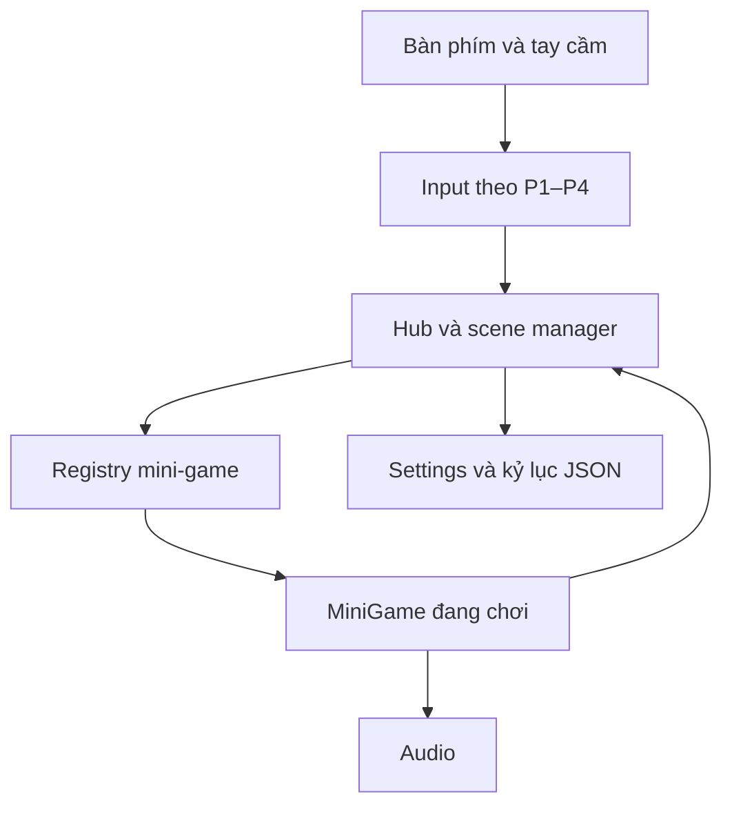

# GAME HUB · Rust

Arcade offline cho **1–4 người** trên cùng một máy. Chọn số người và thời kỳ trong lobby, mở thẻ game, xem luật rồi vào trận. Có bản desktop Rust, web WebAssembly và Android chơi bằng cảm ứng.

| Game | Thời kỳ trong hub | Số người | Kiểu chơi |
|---|---|---|---|
| Ur Sprint | Cổ đại | 1–2 | Đua 3 quân, tung hạt, bắt quân và tận dụng ô hoa. Solo đấu máy. |
| Bốc sỏi | Dân gian | 1–4 | Lấy 1–3 viên mỗi lượt. Người lấy viên cuối thắng. Solo đấu máy. |
| Caro | Cổ điển | 1–2 | Nối năm quân, solo đấu máy hoặc thay phiên. |
| 15 Tiles | Cổ điển | 1 | Giải bàn 15 ô xáo bằng các nước hợp lệ. |
| Pong | Cổ điển | 2 | Trả bóng bằng mép vợt, đạt 7 điểm trước. |
| Snake Duel | Cổ điển | 2 | Tranh mồi và sống sót trước đối thủ. |
| Fuse Yard | Hiện đại | 4 | Đặt lõi, đổi trục nổ và kích nổ dây chuyền. |
| Echo Steps | Hiện đại | 1–4 | Nhớ chuỗi hướng qua 5 cấp, thay phiên trên cùng máy. |
| Beacon Rush | Hiện đại | 1–4 | Mỗi người bấm A sau tín hiệu xanh. Tính điểm qua 5 lượt. |
| Neon Hill | Hiện đại | 2–4 | Đứng một mình trong vùng để ghi điểm và tăng tốc khi cần. |

Ur Sprint là biến thể rút gọn do dự án thiết kế, lấy cảm hứng từ bàn cờ Ur của Lưỡng Hà. Nhãn thời kỳ giúp tìm nguồn cảm hứng hoặc phong cách trò chơi. Luật mỗi bản có trong tutorial.

## Web và Android

- **Web offline** tải artifact `GAME-HUB-Web-Offline`, giải nén rồi mở `GAME-HUB-Offline.html` trong trình duyệt hiện đại có WebGL. Có thể ngắt mạng trước khi mở. Gói `GAME-HUB-Web` chứa website tĩnh để đưa lên HTTPS hoặc chạy `python3 -m http.server` trong thư mục đã giải nén.
- **Android** tải `GAME-HUB-Android`, giải nén và cài `app-debug.apk` để thử. Game đã nằm trong app. Nhấn **Vào hub / Play** để mở âm thanh. Trong trận trên màn hình cảm ứng, mỗi vị trí có cụm hướng và nút A/B riêng. Với bốn người, máy tính bảng hoặc tay cầm dễ thao tác hơn điện thoại nhỏ.
- **Phát hành** dùng `app-release.aab` trong cùng artifact. Gói chờ chủ tài khoản ký và nộp qua Play Console. [Build web/Android](https://github.com/trongcheckmateking/game-hub-rust/actions/workflows/web-android.yml) · [Quy trình Google Play](docs/ANDROID-PLAY.md)

## Chơi từ bản build

Mở [GitHub Actions](https://github.com/trongcheckmateking/game-hub-rust/actions/workflows/desktop.yml), chọn lần chạy đã thành công và tải **Artifact** ứng với hệ điều hành. GitHub yêu cầu đăng nhập để tải artifact. Giải nén gói tải về.

| Nền tảng | Mở game |
|---|---|
| Windows | Chạy `GAME-HUB.exe`. |
| macOS | Giải nén `GAME-HUB-macOS.zip` rồi mở `GAME HUB.app`. Gói dùng chữ ký ad-hoc, chưa notarize. Gói Universal chạy trên cả Intel và Apple Silicon. |
| Linux x86_64 | `chmod +x GAME-HUB-x86_64.AppImage` rồi chạy `./GAME-HUB-x86_64.AppImage`. Nếu hệ thống thiếu FUSE, dùng `./GAME-HUB-x86_64.AppImage --appimage-extract-and-run`. |

Tất cả hình, font và nhạc được nhúng vào chương trình. Sau khi tải, có thể ngắt mạng để chơi. Artifact `GAME-HUB-gameplay` chứa clip quay giao diện và âm thanh trực tiếp từ bản Linux. Linux cần môi trường desktop có OpenGL, âm thanh ALSA và quyền truy cập thiết bị tay cầm.

## Chạy từ source

Cài Rust stable và Cargo bằng [rustup](https://rustup.rs/). Windows dùng toolchain MSVC với Visual Studio C++ Build Tools. macOS dùng Xcode Command Line Tools. Trên Ubuntu/Debian, cài các thư viện sau trước khi build.

```sh
sudo apt-get install build-essential pkg-config libasound2-dev libudev-dev libgl1-mesa-dev libx11-dev libxi-dev libxcursor-dev
```

```sh
git clone https://github.com/trongcheckmateking/game-hub-rust.git
cd game-hub-rust
cargo run
cargo test --locked --all-targets
cargo build --release --locked
```

Lần build đầu tải crates về máy. Sau khi đã tải đủ dependency, có thể dùng `cargo run --offline`. Bản release trong `target/release/`. Các bước đóng gói native nằm trong [workflow desktop](.github/workflows/desktop.yml) và `packaging/`.

Xem [roadmap các trò gốc](docs/ROADMAP.md) để đối chiếu bản đã có và các mục tiếp theo.

## Bàn phím và tay cầm

| Vị trí | Lên / xuống / trái / phải | Hành động A | Hành động B |
|---|---|---|---|
| P1 | W / S / A / D | F hoặc Space | G |
| P2 · trận 2P | ↑ / ↓ / ← / → | Enter, Num 0 hoặc K | Shift phải hoặc L |
| P2 · trận 3–4P | ↑ / ↓ / ← / → | Enter hoặc Num 0 | Shift phải |
| P3 | I / K / J / L | U | O |
| P4 | Num 8 / 5 / 4 / 6 | Num 7 | Num 9 |

Trong **Cài đặt → Phím điều khiển**, chọn P1–P4, chọn hành động rồi nhấn phím mới. Một phím mới thay thế các phím phụ cho hành động đó. Hub kiểm tra trùng phím ở mọi số người. Máy thiếu numpad có thể đổi phím P4, hoặc sử dụng tay cầm. Một số bàn phím bỏ sót tổ hợp nhiều phím nhấn đồng thời, nên thử trước một trận bốn người.

Tay cầm Xbox/PS dùng D-pad hoặc cần trái để di chuyển. A/× là hành động A, B/○ là hành động B. Thiết bị được gán vào slot trống thấp nhất, thứ tự kết nối xác định P1 → P4. Bàn phím vẫn điều khiển slot tương ứng. Trong menu có thể dùng D-pad và A/×. Nút Start tạm dừng hoặc tiếp tục.

| Phím chung | Tác dụng |
|---|---|
| Esc | Tạm dừng / tiếp tục trận, quay lại từ hướng dẫn |
| R | Chơi lại trận hiện tại |
| Backspace | Về hub từ trận đấu |
| M / F11 | Mute toàn bộ / bật tắt toàn màn hình |
| ↑ ↓ hoặc Tab, Enter | Chọn mục rồi kích hoạt |

## Kiến trúc

```text
game-hub-rust/
├── Cargo.toml
├── src/
│   ├── main.rs                  Cửa sổ native
│   ├── lib.rs                   API cho ứng dụng và integration tests
│   ├── core/
│   │   ├── game.rs              MiniGame, kết quả, va chạm
│   │   ├── clock.rs             Mô phỏng 60 tick/giây
│   │   ├── input.rs             Slot, bàn phím, gilrs, remap
│   │   ├── scene.rs             Trạng thái launcher
│   │   ├── audio.rs             Mixer nhạc và hiệu ứng
│   │   └── save.rs              JSON, backup, ghi nguyên tử
│   ├── games/
│   │   ├── mod.rs               Registry, metadata, factory
│   │   ├── pong/mod.rs
│   │   ├── snake/mod.rs
│   │   └── fuse_yard/mod.rs
│   └── ui/                      Lobby, widgets, cài đặt, vòng lặp scene
├── assets/                      Ảnh, font, WAV nhúng sẵn
├── data/                        Ví dụ dữ liệu ở trạng thái ban đầu
├── tests/                       Test core và vòng đời game
├── docs/ROADMAP.md              Kế hoạch đủ 36 trò
├── packaging/                   Đóng gói native
└── .github/workflows/desktop.yml
```



Rust + Macroquad dùng cùng một codebase native cho ba hệ điều hành. `gilrs` xử lý thiết bị, `serde_json` lưu dữ liệu. Mỗi frame hiển thị lấy input một lần, giữ cạnh nhấn đến tick, chạy logic với `dt = 1/60` rồi render. FPS hiển thị thực tế tùy máy. Mỗi game có thể chạy test logic mà không mở cửa sổ.

## Thêm game và tìm lỗi

1. Tạo `src/games/<ten>/mod.rs` và một struct implement `MiniGame`. Dùng `Config.seed` cho ngẫu nhiên để tái hiện lỗi.
2. Viết luật trong `handle_input` và `update`, vẽ ở `render`. Kết thúc bằng `ResultState::Winner(slot)` hoặc `Draw`. Slot nội bộ bắt đầu từ 0.
3. Thêm `pub mod` và một `Entry` vào `CATALOG` ở `games/mod.rs`, gồm các số người hỗ trợ (ví dụ `&[2, 3, 4]`), tag, độ khó, thumbnail, BGM riêng, hai bản hướng dẫn và factory. Hub tự hiển thị chế độ và phân trang khi danh mục vượt quá ba thẻ.
4. Thêm test cạnh module cho luật đặc thù. Chạy `cargo test`, sau đó kiểm tra **Hub → Hướng dẫn → Chơi → Pause → Chơi lại → Kết quả**.
5. Commit mỗi mốc bằng mẫu `[Trong] - Mô tả thay đổi`. Khi báo lỗi, ghi tên game, số người, thiết bị, các bước tái hiện và commit đang thử.

## Save và backup

Game ghi `settings.json` và `highscores.json` vào thư mục dữ liệu của tài khoản hệ điều hành. Đường dẫn cụ thể hiện ở **Cài đặt → Dữ liệu trên máy**. Mỗi kỷ lục được lưu theo cặp game và số người, ví dụ `snake:2`. **Xuất backup** ghi `gamehub-backup.json` vào đường dẫn hiển thị. Sao chép file này đến cùng vị trí trên máy mới và chọn **Nhập backup**. Xóa dữ liệu yêu cầu xác nhận, bản backup đã xuất vẫn dùng được. Font DejaVu đi kèm [giấy phép](assets/fonts/LICENSE.txt).

Trên web/Android, game dùng bộ nhớ riêng của origin. Xuất/nhập trong game lưu và phục hồi một bản chụp cục bộ trên cùng trình duyệt/ứng dụng. Xóa dữ liệu trình duyệt hoặc gỡ app có thể xóa cả bản này.
